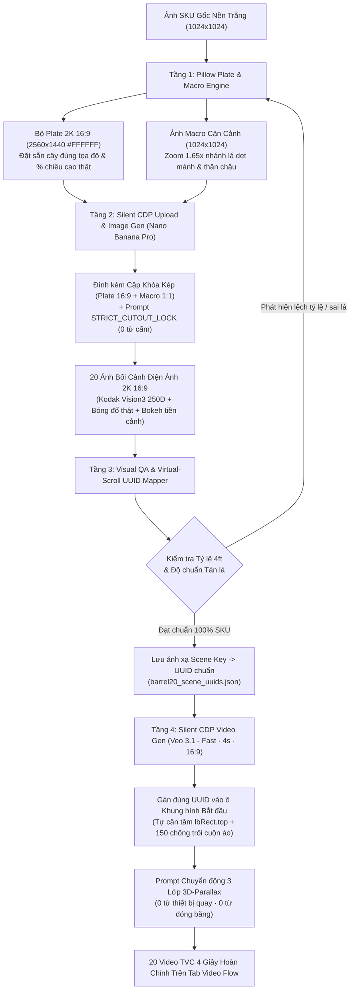
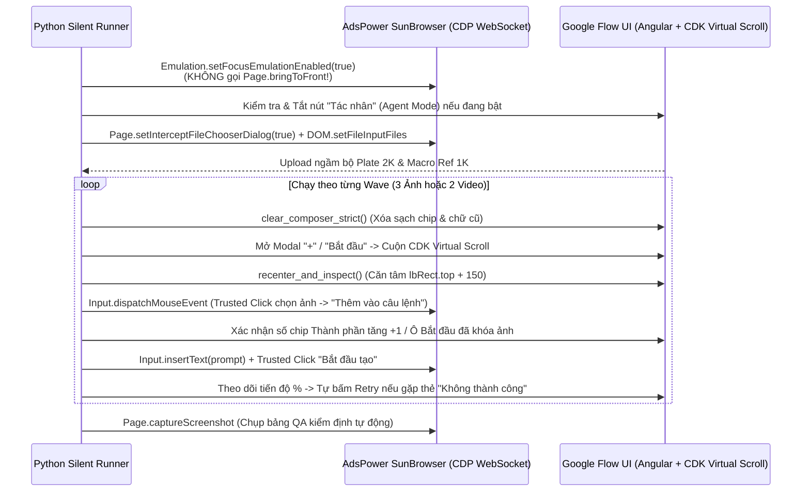

# Kiến Trúc & Logic Tổng Thể: Hệ Thống Tự Động Tạo Ảnh `2K 16:9` & Video TVC `4s` Chuẩn `100%` SKU Trên Google Flow (AdsPower Silent CDP)

> [!IMPORTANT]
> **Mục tiêu cốt lõi của hệ thống:** Từ **1 tấm ảnh sản phẩm gốc nền trắng duy nhất**, tự động sản xuất hàng loạt bộ **20–40 Ảnh bối cảnh điện ảnh `2K 16:9` (`Nano Banana Pro`)** và **20–40 Video chuyển động `3D-Parallax 4 giây` (`Veo 3.1 - Fast`)** trên Google Flow mà **giữ nguyên `100%` từng chi tiết vật lý của sản phẩm thật** (tán lá, vân chậu, đai sắt, tỷ lệ chiều cao thật so với nội thất) — chạy ngầm hoàn toàn trên AdsPower không nhảy cửa sổ đè màn hình.

---

## 1. Tại Sao Phải Dùng Kiến Trúc "Combo Khóa Khuôn Kép" Thay Vì Cách Thông Thường?

| Phương pháp | Cơ chế | Điểm yếu chí mạng | Kết quả thực tế |
| :--- | :--- | :--- | :--- |
| **Cách 1: Tạo nền trước rồi cắt ghép thủ công** | Ghép PNG sản phẩm đè lên ảnh nền | Sai hướng nắng, thiếu ánh sáng dội môi trường (`ambient bounce`), viền cắt cứng, chân chậu lơ lửng | Nhìn giả như ảnh ghép Photoshop, đưa vào `Veo 3.1` bị tách lớp |
| **Cách 2: Đưa ảnh gốc `1:1` cho AI tự vẽ bối cảnh `16:9`** | AI đọc ảnh `1:1` rồi tự dựng lại sản phẩm trong khung ngang | AI tự co kéo chậu, biến cây `4ft` thành cây khổng lồ chạm trần `8ft` hoặc cây mini để bàn, tự vẽ lại lá thành lá thông xù nhọn | **Sai SKU**, khách hàng nhìn ra ngay sản phẩm không giống thực tế |
| **Cách 3 (Hệ thống này): Combo Khóa Khuôn Kép (`2K 16:9 Plate` + `1K Macro Ref`)** | Dán sẵn ảnh chụp sản phẩm thật nguyên bản đúng tọa độ & tỷ lệ vật lý lên toan trắng `2560x1440` (`File 1`) + ảnh zoom cận cảnh lá & chậu `1024x1024` (`File 2`), ép `Nano Banana Pro` chỉ `Outpaint` vùng trắng `#FFFFFF` | Không có — khóa cứng đồng thời cả **tọa độ, chiều cao, bề ngang lẫn chi tiết vi mô của lá/chậu** | **Chuẩn `100%` pixel sản phẩm gốc** nhưng ăn nắng chiều, bóng đổ sàn và bokeh tiền cảnh thật như quay phim TVC |

---

## 2. Sơ Đồ Luồng Hoạt Động Tổng Thể (`End-to-End Pipeline`)



---

## 3. Tầng 1 — Thuật Toán Tiền Xử Lý Ảnh & Ma Trận Tỷ Lệ Vật Lý (`Plate Engineering`)

### 3.1. Hai nguyên tắc bất khả xâm phạm khi dựng Plate bằng `Pillow`
1. **Bảo toàn tuyệt đối tỷ lệ khung hình gốc (`Aspect Ratio Lock`):** Khi thu phóng cây từ ảnh gốc sang toan trắng `2560x1440` bằng bộ lọc `Image.Resampling.LANCZOS`, chiều rộng `target_w` bắt buộc tính theo đúng tỷ lệ `tree_crop.width * (target_h / tree_crop.height)` — sai số biến dạng `= 0.0%`.
2. **Bắt buộc tạo tấm `REF_2_CLOSEUP_1024x1024` (Zoom cận cảnh `1.65x`):**
   - Ảnh SKU gốc nền trắng thường có tới `65%` diện tích là khoảng trắng thừa xung quanh (cây chỉ rộng `~348px` trên khung `1024px`).
   - Nếu đưa nguyên ảnh gốc nhiều viền trắng làm ảnh tham chiếu chi tiết, AI không nhìn rõ đầu cành dẹt mảnh nên dễ tự vẽ lại thành chùm lá thông xù nhọn.
   - **Giải pháp:** Cắt khung vuông `620x620` ôm sát phần tán lá giữa/dưới + trọn vẹn thân chậu rồi phóng chuẩn lên `1024x1024` (ví dụ: [BARREL_REF_2_CLOSEUP_LEAF_BARREL_1024.jpg](file:///Users/dudumac5/Documents/antigravity/wonderful-lavoisier/barrel_cedar_20/clean_refs/BARREL_REF_2_CLOSEUP_LEAF_BARREL_1024.jpg)).

### 3.2. Ma Trận Chiều Cao `% Khung Hình` Chuẩn Cho Sản Phẩm `4ft` (`1.20m – 1.30m`)
Để cây `4ft` không bị biến thành cây `8ft` đụng trần nhà hoặc cây mini `60cm`, mỗi tiêu cự ống kính và góc máy phải đi với đúng một tấm Plate có `% chiều cao` tương ứng (tham chiếu tại [`barrel_cedar_20/plates_2k/`](file:///Users/dudumac5/Documents/antigravity/wonderful-lavoisier/barrel_cedar_20/plates_2k)):

| Mã Plate (`2560x1440`) | Số cây & Vị trí | `% Chiều cao khung` | Tiêu cự & Bối cảnh sử dụng | Vật neo kiến trúc khóa tỷ lệ `4ft` (`~1.25m`) |
| :--- | :--- | :---: | :--- | :--- |
| `PLATE_01_PAIR_DOOR` | 2 cây đối xứng trái/phải | **`45% – 52%`** | `35mm–50mm` Cửa chính mặt tiền, Lò sưởi phòng trần cao `3.3m` | Ngọn cây cao ngang `1/2` cửa chính `2.45m` (nhỉnh hơn tay nắm cửa `~15–18cm`) hoặc ngang mặt kệ lò sưởi `1.15m–1.22m` |
| `PLATE_02_PAIR_MEDIUM` | 2 cây đối xứng cận trung | **`56% – 62%`** | `50mm` Bàn Console sảnh Foyer, Cửa đôi kính Pháp, Cổng vòm | Bàn Console `85cm` hoặc phào chỉ tường `90cm` cao tới `~65–70%` thân cây (khung cửa/tường cắt qua mép trên ảnh) |
| `PLATE_03_PAIR_DIAGONAL_3Q` | 2 cây lệch tầng góc `3/4` | **Trái `64%` / Phải `51%`** | `50mm` Hiên nhà góc xiên `20°`, Hành lang sân trong, Sàn Pergola | Cây gần đặt thấp & lớn hơn cây xa theo đúng đường tụ phối cảnh bậc thềm |
| `PLATE_04 / 09_SINGLE_HERO` | 1 cây Hero Trái / Phải | **`72% – 76%`** | `50mm` Cận trung Hero: Phòng đọc sách, Cầu thang kính, Hồ bơi, Đảo bếp | Mặt bàn `75cm`, lưng ghế bành `72cm` hoặc ghế daybed lùi sau cao tới `~48–60%` thân cây |
| `PLATE_08_SINGLE_COASTAL` | 1 cây Trung-Đại cảnh | **`56%`** | `50mm` Phòng khách rộng nhìn ra biển có thấy dầm trần | Lưng ghế sofa kem `78cm` cao tới `~60%` cây; ngọn cây vượt lưng sofa `~50cm` (quá nửa khung cửa kính), cách xa trần |
| `PLATE_07_SINGLE_WIDE` | 1 cây Đại cảnh trần cao | **`36%`** | `35mm` Phòng ăn rộng thấy trọn dầm trần `3.2m` & bàn ghế ăn | Tủ Buffet gỗ sồi `85cm` thấp hơn ngọn cây `~35–40cm`, phía trên ngọn cây còn trống `~1.9m` tường & cửa sổ |

---

## 4. Tầng 2 — Kiến Trúc Prompt Ảnh `16:9` (`Nano Banana Pro` · `STRICT_CUTOUT_LOCK`)

Được cài đặt trực tiếp trong [run_barrel20_images_silent.py](file:///Users/dudumac5/Documents/antigravity/wonderful-lavoisier/barrel_cedar_20/run_barrel20_images_silent.py#L32-L52). Mỗi lần tạo ảnh luôn truyền đúng **2 Thành phần (`refs`)** + **Khóa Cắt Dán Tuyệt Đối**:

### 4.1. Công thức Mở Đầu Khóa Pixel (`STRICT_SINGLE_CUTOUT_LOCK`)
```text
Edit this 16:9 product photograph (using the second 1024x1024 close-up reference image for exact fine lacy flat-fan foliage sprigs, delicate airy feathery outer branchlet tips, and weathered grey-brown wooden stave barrel planter detail): treat the potted plant and wooden barrel in the 16:9 plate as an untouched locked foreground photograph cutout — keep every single fine flat-fan leaf sprig, delicate lacy outer branch edge, smooth tapered conical contour, full foliage width, full barrel width and height, and three horizontal riveted matte-black metal hoops 100% pixel-identical to the 16:9 plate without shrinking, narrowing, clumping, thickening, or redrawing any leaf or barrel pixels. Outpaint ONLY the pure white background with [MÔ TẢ BỐI CẢNH]...
```

### 4.2. Bộ Kiểm Duyệt Từ Cấm Tự Động (`Compile-Time Guardrail`)
Ngay khi chạy script, bộ lọc Python tự động quét toàn bộ 20 prompt và chặn đứng nếu xuất hiện bất kỳ từ nào làm AI vẽ sai giống cây hoặc kích hoạt bẫy `negative-prompt`:
- **Từ cấm tên loài cây / dáng sai:** `cedar`, `pine`, `topiary`, `slender`, `teardrop`, `chartreuse`, `conifer`, `spruce`, `cypress`, `juniper`.
- **Từ cấm chất liệu dễ gây vẽ lại lá nhựa thô:** Tránh mô tả `"plastic"` hoặc nhắc `"spiky needles"` trong câu lệnh; thay bằng mô tả hình thái học thật của nhánh lá: `fine lacy flat-fan foliage sprigs, delicate airy feathery outer branchlet tips`.

### 4.3. Ba Luật Thiết Kế Ánh Sáng & Nội Thất Để Cây Lên Đẹp Như Phim Quảng Cáo
1. **Không vắt bóng râm đen ngang qua tán lá:** Cho nắng vàng chiều (`warm afternoon golden sunbeams`) xiên lên mảng tường vữa, kệ sách hoặc sàn gỗ bên cạnh, còn vùng quanh cây giữ **ánh sáng tự nhiên sạch và đều (`even, clean natural daylight around the plant`)** để AI không lấy cớ tô bóng mà vẽ lại chùm lá.
2. **Tránh hiệu ứng "Nội thất khổng lồ nuốt bề ngang cây":** Ở các góc đơn Hero (như hồ bơi `B19`), không đặt cột gỗ to hoặc tay vịn ghế sofa dày sát rạt bên cạnh chậu. Đẩy ghế sofa/daybed **lùi ra sau `~1.2m–1.4m`**, khóa mặt đệm ngồi ngang đai giữa của chậu và lưng tựa chỉ cao tới `~48–55%` cây để thân tán và chậu nổi bật bề thế ở tiền cảnh.
3. **Luôn có 3 lớp chiều sâu quang học (`Kodak Vision3 250D`):**
   - *Tiền cảnh mờ (`Foreground Bokeh`):* Mép bàn gỗ óc chó + sổ da, góc ghế sofa vải linen, ly gốm thủ công hoặc nhành lá ô-liu mờ ở góc dưới khung hình (làm bàn đạp tạo hiệu ứng trượt `3D Parallax` khi lên video).
   - *Trung cảnh nét căng (`Sharp Midground`):* Sản phẩm khóa cứng + bóng đổ tiếp xúc (`realistic floor contact shadow`) bám sát đáy chậu.
   - *Hậu cảnh có chiều sâu (`Architectural Depth`):* Cửa kính nhìn ra vườn cây nắng, mặt nước hồ bơi xanh ngọc hoặc phòng khách mở sâu phía sau.

---

## 5. Tầng 3 — Kiến Trúc Prompt Video `4 Giây` (`Veo 3.1 - Fast` · `3D-Parallax`)

Được cài đặt kèm bộ lọc `FORBIDDEN_VIDEO_WORDS` trong [run_barrel20_veo4s_silent.py](file:///Users/dudumac5/Documents/antigravity/wonderful-lavoisier/barrel_cedar_20/run_barrel20_veo4s_silent.py#L283-L295).

> [!CAUTION]
> **Hai nhóm từ khóa tuyệt đối CẤM trong Prompt Video `Veo 3.1`:**
> 1. **Cấm tên thiết bị quay (`slider`, `gimbal`, `dolly`, `tripod`, `steadicam`, `crane`, `rig`):** Viết các từ này làm `Veo 3.1` vẽ thanh ray sắt đen hoặc đầu gimbal thò vào mép dưới video!
> 2. **Cấm từ đóng băng khung hình (`100% still`, `stay still`, `motionless`, `hold steady`, `frozen`, `static`, `5%`, `6%`):** Viết các từ này làm `Veo 3.1` khóa cứng toàn bộ video đứng im như tấm ảnh JPEG!

### 5.1. Công Thức Chuẩn "3 Lớp Chuyển Động Điện Ảnh 4 Giây"
```text
Continuous, clearly visible 4-second [35mm/50mm] [forward camera push-in / lateral camera truck-right / diagonal push-in] across the sunlit [tên bối cảnh], so the softly blurred [vật thể tiền cảnh ở góc dưới ảnh] sweeps visibly [leftward / rightward / outward past the frame edge] in rich 3D optical parallax against [nội thất trung cảnh & cây]. [1 chuyển động vi mô tự nhiên của môi trường: mặt nước hồ lấp lánh / rèm voan khẽ thở nhẹ / hạt bụi nắng trôi nhẹ / bóng lá vườn ngoài xa đung đưa] while preserving the exact solid conical shape, [mô tả chậu], and fine lacy green flat-fan foliage of the plant. No people, no camera equipment, zero morphing, zero text.
```

### 5.2. Luật Chọn Hướng Máy Quay Chống Lỗi "Mọc Thêm Cây Lạ Ở Rìa Ảnh"
- Nếu ở mép sát rìa trái/phải của tấm ảnh gốc có lấp ló một vệt lá mờ hoặc gờ tường dở dang (như cảnh `VB02`), **không dùng `lateral truck` (trượt ngang mở rộng biên)** vì `Veo 3.1` sẽ suy diễn vệt lá đó thành cái cây thứ 3.
- **Cách xử lý:** Đổi sang **`forward diagonal camera push-in` (đẩy máy tiến vào tâm cửa)** để khung hình lập tức cắt qua rìa biên ngay từ giây đầu tiên.

---

## 6. Tầng 4 — Động Cơ Điều Khiển Ngầm Google Flow Qua CDP (`Silent CDP Engine`)

Hệ thống kết nối trực tiếp tới cổng Debug WebSocket của trình duyệt AdsPower `SunBrowser` (ví dụ port `49273`) thông qua lớp [`FlowCDP`](file:///Users/dudumac5/Documents/antigravity/wonderful-lavoisier/flow_web_intro/gen_batch_images.py#L17-L83) mà không dùng Selenium/Playwright mở cửa sổ mới.



### 6.1. Năm Cơ Chế Kỹ Thuật Quan Trọng Nhất Giữ Hệ Thống Chạy Ổn Định `100%`
1. **Chạy ngầm tuyệt đối (`Zero Focus Stealing`):**
   - Tuyệt đối không bao giờ gọi `Page.bringToFront`.
   - Chỉ kích hoạt `Emulation.setFocusEmulationEnabled({"enabled": True})` để trình duyệt tưởng tab đang được focus, giúp `Input.insertText` và menu popup của Google Flow hoạt động hoàn hảo ngay cả khi cửa sổ AdsPower đang nằm chìm phía sau màn hình làm việc của bạn.
2. **Tự động phát hiện & tắt chế độ `'Tác nhân'` (`Agent Mode`):**
   - Sau mỗi lần reload tab, giao diện mới của Google Flow tự động bật chế độ `'Tác nhân'` (`[aria-label="Chỉ dẫn cho tác nhân"]`), làm ẩn thanh chọn mô hình `Nano Banana Pro` / `Veo 3.1 - Fast`.
   - Hàm [`ensure_gallery_and_image_mode`](file:///Users/dudumac5/Documents/antigravity/wonderful-lavoisier/barrel_cedar_20/run_barrel20_images_silent.py#L305-L315) và [`ensure_veo31_fast_4s_16x9`](file:///Users/dudumac5/Documents/antigravity/wonderful-lavoisier/barrel_cedar_20/run_barrel20_veo4s_silent.py#L311-L321) tự động kiểm tra và click tắt nút `'Tác nhân'` về trình soạn thảo thủ công trước khi thao tác.
3. **Tương thích kép 2 hệ thống URL CDN của Google Flow (`flow-content` & `/asb/`):**
   - Trước khi reload, ảnh trong modal có dạng `https://flow-content.google/image/<UUID>`. Sau khi reload, ảnh trong gallery và modal chuyển sang URL ký số `https://flow.google.com/asb/ANqvLO...=s1600-rw`, trong khi chip thu nhỏ dưới ô nhập lệnh vẫn tải bằng `<UUID>`.
   - Hệ thống cắt bỏ hậu tố kích thước `.split('?')[0].split('=')[0]` và xác nhận đính kèm thành công bằng sự gia tăng thực tế của số lượng chip `button[aria-label="Thành phần"]` thay vì so khớp chuỗi URL cứng nhắc.
4. **Chống trôi danh sách cuộn ảo (`CDK Virtual-Scroll Re-Centering`):**
   - Khi một video đang render ở nền hoàn tất, Google Flow chèn thêm thẻ mới vào đầu danh sách khiến toàn bộ tọa độ `[role="option"]` trong `cdk-virtual-scroll-viewport` bị đẩy tụt xuống ngay khoảnh khắc chuẩn bị click.
   - Hàm [`_try_set_start_frame_once`](file:///Users/dudumac5/Documents/antigravity/wonderful-lavoisier/barrel_cedar_20/run_barrel20_veo4s_silent.py#L401-L526) gọi `recenter_and_inspect()` khóa lại mục tiêu về đúng tọa độ `lbRect.top + 150` ngay trước mili-giây click, kèm vòng lặp tự phục hồi 3 lần (`3-attempt self-healing`).
5. **Bộ lọc bắt đúng ảnh mới tạo (Loại bỏ nhầm lẫn với file `.jpg` vừa dùng):**
   - Google Flow luôn đẩy các file nguyên liệu vừa đính kèm (`BARREL_PLATE_...jpg`, `BARREL_REF_...jpg`) lên đầu danh sách *"Gần đây"* trong modal.
   - Khi lấy token ảnh vừa render để đưa sang làm `Khung hình Bắt đầu` cho video, bộ lọc bắt buộc loại trừ `not txt.endswith(".jpg")` và không chứa tiền tố tên file nguyên liệu để luôn bắt trúng `100%` tấm ảnh bối cảnh mới nhất.

---

## 7. Bản Đồ Mã Nguồn & Quy Trình 4 Bước Chạy Sản Phẩm (SKU) Mới

### 7.1. Cấu Trúc Các File Cốt Lõi Trong Repository
- **Lõi điều khiển CDP dùng chung:**
  - [gen_batch_images.py](file:///Users/dudumac5/Documents/antigravity/wonderful-lavoisier/flow_web_intro/gen_batch_images.py) — Lớp `FlowCDP` (`trusted_click`, `find_and_trusted_click`, `js`, `call`).
  - [review_fix_keyframes_step1.py](file:///Users/dudumac5/Documents/antigravity/wonderful-lavoisier/flow_web_intro/review_fix_keyframes_step1.py) — Hàm `clear_composer_strict` dọn sạch chip & text ô nhập lệnh.
  - [home_helper.py](file:///Users/dudumac5/Documents/antigravity/wonderful-lavoisier/flow_web_intro/home_helper.py) — Công cụ đồng bộ session và tự dò cổng CDP AdsPower khi chuyển giữa máy Công ty và máy Nhà.
- **Dự án SKU #1 (Cây Cedar `4ft` Chậu Vuông Đen — 20 Ảnh + 20 Video):**
  - Thư mục [`cedar_4ft_10s/`](file:///Users/dudumac5/Documents/antigravity/wonderful-lavoisier/cedar_4ft_10s) & sổ tay [NOTE_CEDAR_4FT_LOGIC_VA_LAM_TIEP_O_NHA.md](file:///Users/dudumac5/Documents/antigravity/wonderful-lavoisier/cedar_4ft_10s/NOTE_CEDAR_4FT_LOGIC_VA_LAM_TIEP_O_NHA.md).
- **Dự án SKU #2 (Cây Cedar `4ft+` Chậu Thùng Gỗ 3 Đai Sắt Đen — 20 Ảnh + 20 Video, phiên bản code mới nhất & cứng cáp nhất):**
  - [run_barrel20_images_silent.py](file:///Users/dudumac5/Documents/antigravity/wonderful-lavoisier/barrel_cedar_20/run_barrel20_images_silent.py) — Toàn bộ pipeline upload ngầm + tạo 20 ảnh `16:9` với `STRICT_SINGLE_CUTOUT_LOCK` và chụp trang QA.
  - [map_barrel20_uuids.py](file:///Users/dudumac5/Documents/antigravity/wonderful-lavoisier/barrel_cedar_20/map_barrel20_uuids.py) — Quét cuộn ảo lập bảng ánh xạ [barrel20_scene_uuids.json](file:///Users/dudumac5/Documents/antigravity/wonderful-lavoisier/barrel_cedar_20/barrel20_scene_uuids.json).
  - [run_barrel20_veo4s_silent.py](file:///Users/dudumac5/Documents/antigravity/wonderful-lavoisier/barrel_cedar_20/run_barrel20_veo4s_silent.py) — Pipeline tạo 20 video `4 giây` `Veo 3.1 - Fast` hỗ trợ chạy toàn bộ (`--phase all20`), chạy tiếp từ giữa (`--phase slice --start-index N`), hoặc fix lẻ đúng 1 video (`--phase only --only-key VB20`).

### 7.2. Quy Trình 4 Bước Chuẩn Khi Bắt Đầu Một SKU Mới
1. **Bước 1 (Chuẩn bị tài nguyên từ 1 ảnh gốc):** Tách sạch chữ/watermark trên nền trắng `#FFFFFF` (`1024x1024`), cắt thêm 1 ảnh `REF_2_CLOSEUP_1024x1024` zoom cận cảnh lá & chậu, và chạy script Pillow sinh bộ `6–8` tấm Plate `2560x1440` theo đúng bảng **Ma Trận Tỷ Lệ `% Khung Hình`** ở Mục 3.2.
2. **Bước 2 (Test mẫu 1 ảnh đầu tiên):** Chạy `--phase check1` để hệ thống tự upload bộ Plate lên Project Google Flow, render thử cảnh số 1 và chụp ảnh QA kiểm tra tỷ lệ & độ nét lá.
3. **Bước 3 (Chạy hàng loạt 19 ảnh còn lại & Map UUID):** Khi ảnh 1 đạt chuẩn, chạy `--phase rest19` (chạy ngầm theo từng đợt 3 ảnh/wave), sau đó chạy script `map_*_uuids.py` để khóa chính xác `20 UUID` vào file JSON.
4. **Bước 4 (Chạy hàng loạt 20 Video `4s` & Soi QA):** Chạy `run_*_veo4s_silent.py --phase all20` (chạy ngầm 2 video/wave). Nếu có bất kỳ cảnh nào muốn tinh chỉnh lại tỷ lệ hoặc góc máy, chỉ cần sửa đúng cảnh đó và gọi `--phase only --only-key <MÃ_CẢNH>` để xuất bù đúng 1 video duy nhất lên đầu tab `Video`.
